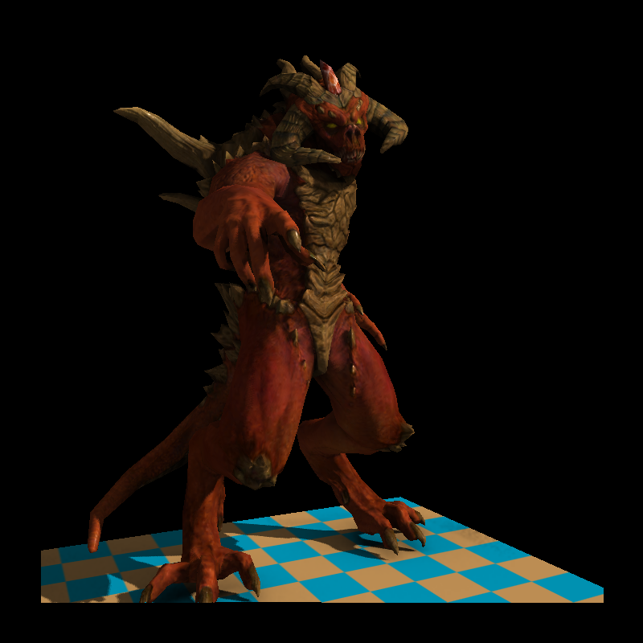
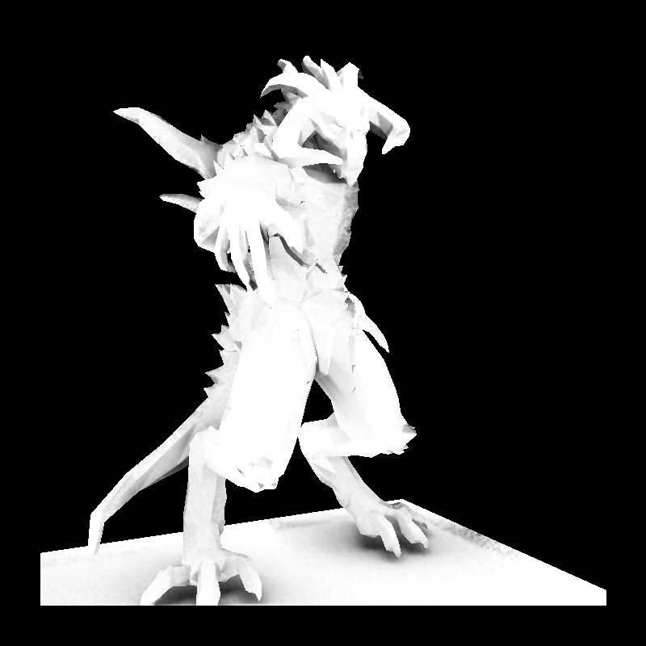
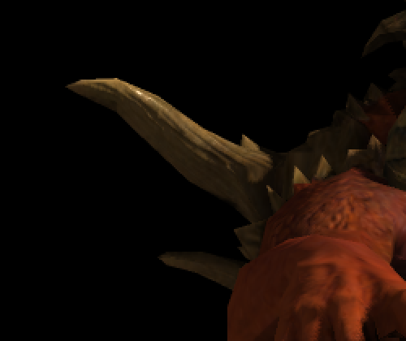
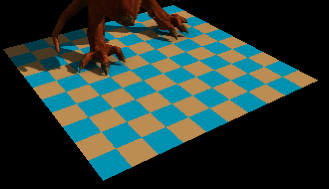
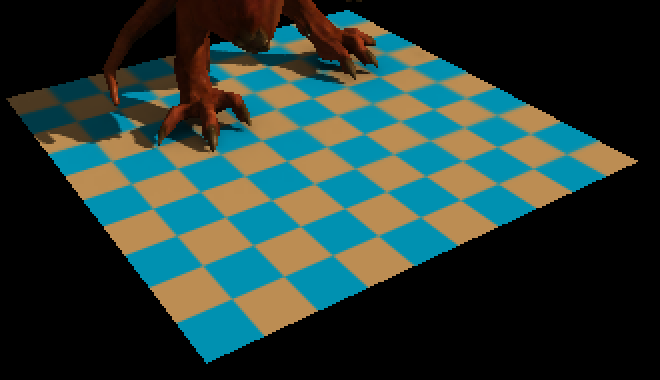
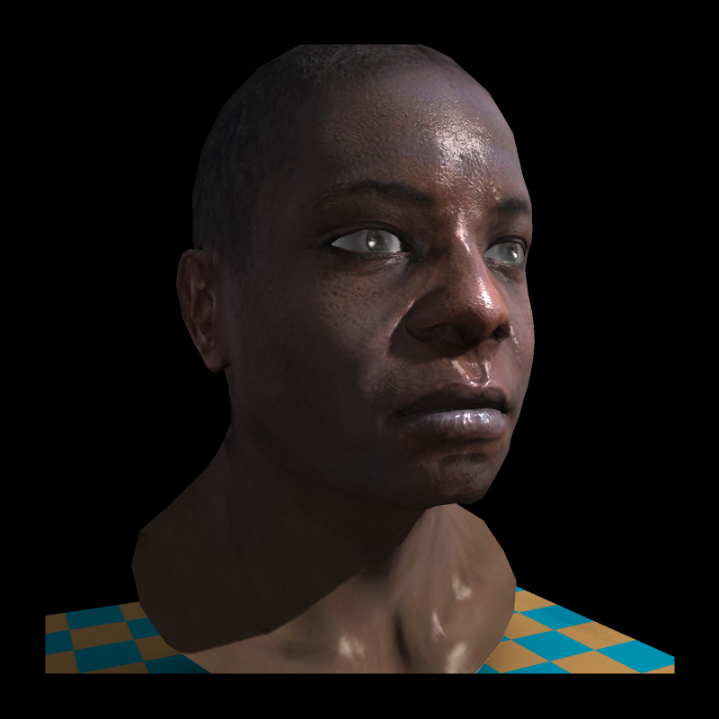

# MiniRenderer

A C++20 CPU software rasterizer built while studying [TinyRenderer](https://github.com/ssloy/tinyrenderer). It renders textured OBJ scenes to TGA images and implements lighting, shadows, transparency, and screen-space ambient occlusion without a graphics API.



## Features

- Triangle rasterization with depth testing, back-face culling, clipping against all six view-frustum planes, and perspective-correct interpolation.
- Diffuse textures, tangent-space normal maps, and specular maps with Phong lighting.
- Bilinear texture sampling and mipmaps with trilinear filtering based on perspective-correct UV derivatives.
- Directional-light shadow mapping using a fitted orthographic light projection and 3×3 percentage-closer filtering.
- Depth-sorted alpha blending for transparent fragments.
- Screen-space ambient occlusion (SSAO) with view-space sampling, depth-aware blur, and ambient-only lighting modulation.
- Optional 4× MSAA with per-sample coverage, depth, and transparent blending. The camera pass bins triangles into horizontal bands that can render in parallel.

The SSAO pass also writes a grayscale diagnostic image:



SSAO uses 32 hemisphere samples within a 0.4 scene-unit radius. A depth- and normal-aware blur reduces noise; the result affects only the ambient term, leaving direct diffuse light and specular highlights intact.

The same silhouette at 2× display zoom, rendered with 1× and 4× coverage sampling:

| 1× | 4× MSAA |
| :---: | :---: |
|  |  |

[View the full 4× render](docs/images/diablo-msaa4.png).

Texture filtering on the distant checkerboard floor, shown at 2× display zoom:

| Nearest | Trilinear mipmapping |
| :---: | :---: |
|  |  |

## Build and run

You need a C++20 compiler and CMake 3.12 or newer. OpenMP is optional; CMake enables it when available.

```sh
cmake -S . -B build -DCMAKE_BUILD_TYPE=Release
cmake --build build -j
ctest --test-dir build --output-on-failure
./build/tinyrenderer obj/diablo3_pose/diablo3_pose.obj obj/floor.obj
```

Run the executable from the repository root so it can find the textures next to the OBJ files. It writes `framebuffer.tga` and `ao.tga` in the current directory. The screenshots above were converted to PNG with `convert framebuffer.tga -auto-orient ...` and `convert ao.tga -auto-orient ...`; the orientation step is needed when displaying these TGA files through ImageMagick. The default is 1× sampling with trilinear texture filtering; use `--msaa 4` for 4× MSAA or `--texture-filter nearest` for a sampling comparison. Add `--timings` to print the time spent loading, rendering shadows, rendering the camera view, and computing SSAO plus writing images.

The camera defaults to `--eye -1 0 2 --center 0 0 0 --up 0 1 0`, with a vertical field of view of about 48.2°, near and far planes at 0.1 and 100, and an 800×800 image. For example, to render a wider image from another viewpoint:

```sh
./build/tinyrenderer --size 960 540 --eye -2 1 3 --center 0 0 0 \
  --fov 55 --near 0.1 --far 20 \
  obj/diablo3_pose/diablo3_pose.obj obj/floor.obj
```

To render the head and its transparent eye layers:

```sh
./build/tinyrenderer --msaa 4 \
  obj/african_head/african_head.obj \
  obj/african_head/african_head_eye_inner.obj \
  obj/african_head/african_head_eye_outer.obj \
  obj/floor.obj
```



## Rendering pipeline

1. Load triangle meshes and their `_diffuse.tga`, `_nm_tangent.tga`, and `_spec.tga` textures in [`model.cpp`](model.cpp), and generate mip levels in [`texture.cpp`](texture.cpp).
2. Render opaque texels from the light's direction into a shadow depth buffer.
3. Bin triangles into screen bands and render opaque and transparent geometry from the camera with the Phong shader in [`main.cpp`](main.cpp). [`our_gl.cpp`](our_gl.cpp) handles clipping, per-sample rasterization, depth testing, transparency composition, and MSAA resolve.
4. Reconstruct view-space positions and normals from resolved opaque depth, estimate and blur SSAO, then combine direct light with AO-modulated ambient light.

## Performance

The table shows the median of five Release runs of the Diablo scene at 800×800 on an Intel Core i7-14700KF. Set `OMP_NUM_THREADS` to control the number of threads. Times include texture loading and TGA output and will vary by machine.

| MSAA | Threads | Total | Camera pass | SSAO + output |
| --- | ---: | ---: | ---: | ---: |
| 1× | 1 | 514 ms | 113 ms | 243 ms |
| 1× | 4 | 302 ms | 45 ms | 99 ms |
| 4× | 1 | 564 ms | 154 ms | 245 ms |
| 4× | 4 | 336 ms | 73 ms | 102 ms |

The camera pass and SSAO run in parallel. Shadow-map rendering and asset loading, including mipmap generation, are currently serial. The 4× mode uses more memory because it stores separate color, depth, and transparent fragments for each sample.

The directional light, shadow-map size, and SSAO settings are currently fixed in `main.cpp`. The OBJ loader expects triangulated faces with position, UV, and normal indices. The shadow pass treats only fully opaque texels as occluders; SSAO also uses only opaque depth, so transparent layers do not occlude ambient light. These are current limitations of the renderer.

## Project origin

This is an altered and extended implementation of Dmitry V. Sokolov's [TinyRenderer](https://github.com/ssloy/tinyrenderer) tutorial, not the original project. The tutorial's sample meshes and textures are included under `obj/`, and the original license notice is preserved in [`LICENSE.txt`](LICENSE.txt). The `chapter/` directory contains earlier learning-stage implementations; the root sources are the current renderer.
